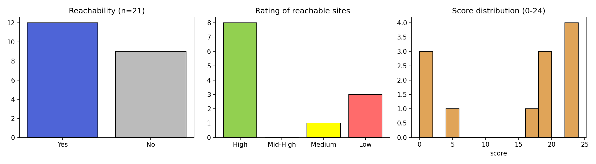

# Website Domain Quality Analyzer

A Python tool that takes a spreadsheet of customer accounts and their website domains and checks, for every domain: whether the website is reachable, how complete it is, what industry it belongs to, and whether the record looks anomalous. The results are written back into the original Excel/CSV file as extra columns, so the input layout is kept as it was.

I built this during my data-analysis internship to replace manual website checks when qualifying sales leads. All data used in examples is synthetic or anonymized.

## Pipeline

```
Raw records (N rows, .xlsx / .csv)
   │
   ├─ Step 0   Preprocess: normalise domains, detect anomalies, de-duplicate
   ├─ Step 1   Reachability check: https/http × bare/www, SSL fallback, thread pool
   ├─ Step 1.5 Search-engine rescue for unreachable domains (extension point)
   ├─ Step 2   18-dimension quality score (0–24)
   └─ Step 3   Merge results back into the original file (+8 columns)
```

Each step saves its intermediate results as JSON, so you can inspect a long run step by step or resume it partway.

## Scoring model (18 dimensions, 0–24)

| Layer | Dimensions | Points |
|---|---|---|
| 1. HTML structure | valid title, meta description, ≥5 links, images, navigation, footer | 6 × 1 |
| 2. Content richness | ≥200 chars of text, headings, forms, media/embeds, lists, structured data | 6 × 1 |
| 3. Business signals | contact info, products/pricing, social links, call-to-action, blog/news, privacy/terms | 6 × 2 |

Layer 3 counts double because it is the strongest evidence of a real, operating business rather than a parked or placeholder page.

| Rating | Score |
|---|---|
| ★★★ High | ≥ 17 |
| ★★ Mid-High | 10–16 |
| ★ Medium | 5–9 |
| ☆ Low | 0–4 |

The scorer is implemented twice with identical rules:
- `score_html()` (Python, regex on fetched HTML). It is fast and needs no browser.
- `SCORING_JS` (in-browser JavaScript). Use it with Playwright when you need to score JavaScript-rendered pages.

## Other features

- **Anomaly detection:** flags bulk-registered domains (the same name under ≥3 TLDs), duplicates across accounts, `.edu` / `.ac` domains, and public mail providers (gmail.com, qq.com, …). Flagged rows are skipped in later steps, so no requests are wasted on them.
- **Robust reachability:** tries both the www and bare-domain hosts, and retries with SSL verification disabled when a certificate is invalid. Responses blocked by a WAF or login wall (401/403/429/503) are still counted as "site exists".
- **Encoding repair:** detects the real charset from `<meta>` so that Chinese pages are not decoded as garbled text. When reading CSV files it falls back through UTF-8, GBK and Latin-1.
- **Industry keywords:** bilingual (English and Chinese) regex patterns for 10 industries.
- **Overseas-entity detection:** a prioritised rule chain using the company name, ICP filing numbers, `<html lang>`, and the ratio of Chinese characters to Japanese kana and Korean hangul.

## Output columns

`Reachable` · `URL Used` · `Score (0-24)` · `Rating` (colour-coded in Excel) · `Industry Keywords` · `Overseas Entity` · `Anomaly` · `Note`

## Example run

[`examples/sample_input.csv`](examples/sample_input.csv) contains 21 domains. [`examples/sample_output_bilingual.xlsx`](examples/sample_output_bilingual.xlsx) is the tool's output. It was produced by the original Chinese-language version, so every Chinese result column has its English translation next to it. A CSV copy is also provided.



| Metric | Value |
|---|---|
| Domains | 21 |
| Reachable | 12 (57%) |
| Rating (reachable) | 8 High · 1 Medium · 3 Low |
| Median score | 19 / 24 |
| Anomalies flagged | 1 mail-provider domain (mail.ru) |

Sample rows:

| domain | Reachable | Score | Rating | Industry Keywords | Overseas |
|---|---|---|---|---|---|
| adsboostor.com | Yes | 22 | ★★★ High | E-commerce, IT Services/Software, Media/Content | Yes |
| ecoglobal.vip | Yes | 1 | ☆ Low | IT Services/Software, Media/Content | Yes |
| mail.ru | No | – | – | – (Anomaly: Mail provider domain) | – |

## Usage

```bash
pip install requests openpyxl
python domain_analysis.py ./data/accounts.xlsx    # or .csv
```

The input needs a column whose header contains `domain` / `website` (or `域名` / `网站`). A company-name column is detected automatically.

## Limitations & next steps

- `score_html()` cannot see content that is only rendered client-side; for those sites, run `SCORING_JS` in a headless browser.
- Redirects are followed but not re-checked: e.g. `bk.ru` redirects to `mail.ru` and still scores 19/24, because the destination is scored rather than the original domain. A fix would be to re-run the mail-provider / anomaly check on the final URL after redirects.
- Step 1.5 (search rescue) is a stub, ready to plug into a search API.
- The weights are hand-set. A next step would be to fit them against labelled lead outcomes, for example with logistic regression.

## Author
Peiran (Cynthia) Jing · [github.com/pr000000](https://github.com/pr000000)
